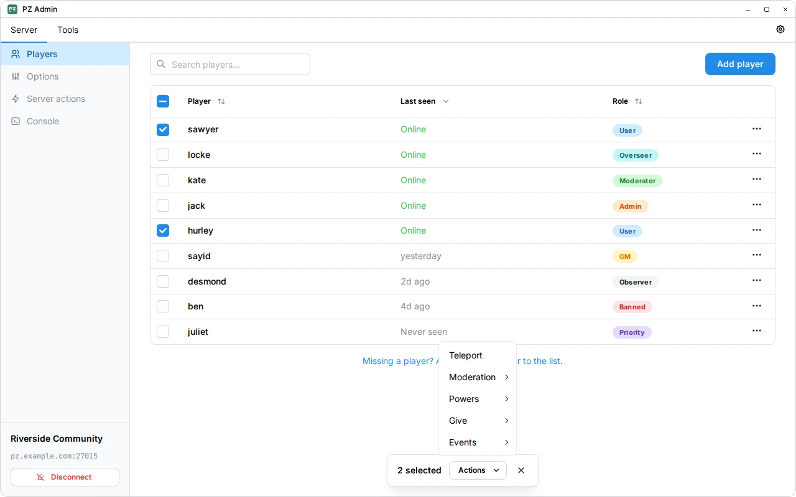

# PZ Admin

PZ Admin is a desktop application for managing Project Zomboid servers.
Manage players, edit server options, and run console commands from one interface.

[Website](https://beyenilmez.github.io/pz-admin/) ·
[Releases](https://github.com/beyenilmez/pz-admin/releases) ·
[Report an issue](https://github.com/beyenilmez/pz-admin/issues/new/choose)

<picture>
  <source media="(prefers-color-scheme: dark)" srcset="assets/screenshots/players/en-US/players-en-US-dark-1280x800.webp">
  
</picture>

## Features

- Manage players: assign roles, grant XP, teleport, and perform moderation actions.
- Give items to players and spawn vehicles using searchable catalogs.
- Edit server options and run console commands.
- Compose messages with a rich text editor that supports Project Zomboid formatting.
- Control the weather, trigger server events, and save the world.
- Connect to your servers through RCON and save connection profiles.

The item browser, vehicle browser, and message editor can also be used without
connecting to a server. PZ Admin includes catalogs and options for Builds 41 and 42.

## Download

Choose the download for your operating system and processor.

<table>
  <thead>
    <tr>
      <th scope="col">Platform</th>
      <th scope="col">Package</th>
      <th scope="col">x64 (amd64)</th>
      <th scope="col">ARM64</th>
    </tr>
  </thead>
  <tbody>
    <tr>
      <th scope="row">Windows</th>
      <td>Installer (.exe)</td>
      <td><a href="https://github.com/beyenilmez/pz-admin/releases/download/v2.0.0/pz-admin-2.0.0-windows-x64-installer.exe">Download</a></td>
      <td><a href="https://github.com/beyenilmez/pz-admin/releases/download/v2.0.0/pz-admin-2.0.0-windows-arm64-installer.exe">Download</a></td>
    </tr>
  </tbody>
  <tbody>
    <tr>
      <th scope="row">macOS</th>
      <td>DMG</td>
      <td><a href="https://github.com/beyenilmez/pz-admin/releases/download/v2.0.0/pz-admin-2.0.0-macos-x64.dmg">Download</a></td>
      <td><a href="https://github.com/beyenilmez/pz-admin/releases/download/v2.0.0/pz-admin-2.0.0-macos-arm64.dmg">Download</a></td>
    </tr>
  </tbody>
  <tbody>
    <tr>
      <th scope="rowgroup" rowspan="4">Linux</th>
      <td>DEB</td>
      <td><a href="https://github.com/beyenilmez/pz-admin/releases/download/v2.0.0/pz-admin-2.0.0-linux-x64.deb">Download</a></td>
      <td><a href="https://github.com/beyenilmez/pz-admin/releases/download/v2.0.0/pz-admin-2.0.0-linux-arm64.deb">Download</a></td>
    </tr>
    <tr>
      <td>RPM</td>
      <td><a href="https://github.com/beyenilmez/pz-admin/releases/download/v2.0.0/pz-admin-2.0.0-linux-x64.rpm">Download</a></td>
      <td><a href="https://github.com/beyenilmez/pz-admin/releases/download/v2.0.0/pz-admin-2.0.0-linux-arm64.rpm">Download</a></td>
    </tr>
    <tr>
      <td>Arch</td>
      <td><a href="https://github.com/beyenilmez/pz-admin/releases/download/v2.0.0/pz-admin-2.0.0-linux-x64.pkg.tar.zst">Download</a></td>
      <td><a href="https://github.com/beyenilmez/pz-admin/releases/download/v2.0.0/pz-admin-2.0.0-linux-arm64.pkg.tar.zst">Download</a></td>
    </tr>
    <tr>
      <td>Flatpak</td>
      <td><a href="https://github.com/beyenilmez/pz-admin/releases/download/v2.0.0/pz-admin-2.0.0-linux-x64.flatpak">Download</a></td>
      <td><a href="https://github.com/beyenilmez/pz-admin/releases/download/v2.0.0/pz-admin-2.0.0-linux-arm64.flatpak">Download</a></td>
    </tr>
  </tbody>
</table>

### Windows

Run the installer.
Windows releases are unsigned. If SmartScreen shows **Windows protected your PC**,
choose **More info → Run anyway**, if available, only if you trust the download
from this project's GitHub Releases.

### macOS

Open the DMG and drag PZ Admin into **Applications**.
The app is not signed with an Apple Developer ID or notarized. If macOS blocks
it because the developer cannot be verified, try opening it once, then go to
**System Settings → Privacy & Security → Open Anyway**. Only approve a download
you trust; see [Apple's instructions](https://support.apple.com/en-us/102445).

### Linux

<details>
<summary>Debian, Ubuntu and derivatives</summary>

Requires Debian 13+ or Ubuntu 24.04+, including compatible derivatives such as
Linux Mint 22, Pop!_OS 24.04, elementary OS 8, Kubuntu and Xubuntu.
Use the repository matching your distribution's base:

| Distribution base | `distro` | `codename` |
| ----------------- | -------- | ---------- |
| Ubuntu 24.04+     | `ubuntu` | `noble`    |
| Debian 13+        | `debian` | `trixie`   |

Set these two values from the table:

```sh
distro=ubuntu
codename=noble
```

Then run in the same terminal:

```sh
sudo apt update
sudo apt install ca-certificates curl
sudo install -d -m 0755 /etc/apt/keyrings
curl -fsSL https://dl.cloudsmith.io/public/beyenilmez/pz-admin/gpg.03280463DB322D3B.key \
  | sudo tee /etc/apt/keyrings/pz-admin.asc > /dev/null
sudo chmod 0644 /etc/apt/keyrings/pz-admin.asc
echo "deb [arch=$(dpkg --print-architecture) signed-by=/etc/apt/keyrings/pz-admin.asc] https://dl.cloudsmith.io/public/beyenilmez/pz-admin/deb/$distro $codename main" \
  | sudo tee /etc/apt/sources.list.d/beyenilmez-pz-admin.list > /dev/null
sudo apt update
sudo apt install pz-admin
```

These repository channels contain PZ Admin packages only. On Ubuntu and its
flavors, enable the `universe` repository if required dependencies are unavailable.

</details>

<details>
<summary>Fedora</summary>

For standard Fedora installations, including Workstation and KDE:

```sh
sudo tee /etc/yum.repos.d/beyenilmez-pz-admin.repo > /dev/null <<'EOF'
[pz-admin]
name=PZ Admin
baseurl=https://dl.cloudsmith.io/public/beyenilmez/pz-admin/rpm/fedora/$releasever/$basearch
enabled=1
skip_if_unavailable=0
gpgcheck=1
repo_gpgcheck=1
gpgkey=https://dl.cloudsmith.io/public/beyenilmez/pz-admin/gpg.03280463DB322D3B.key
sslverify=1
EOF
sudo dnf install pz-admin
```

Other RPM distributions may need different instructions. These commands do not
apply to Fedora Atomic desktops.

</details>

For other distributions, see [Cloudsmith's setup instructions](https://cloudsmith.io/~beyenilmez/repos/pz-admin/setup/).
Cloudsmith generates and maintains these instructions. They may not work for
every distribution, and package compatibility is not guaranteed.

AUR and Flathub packages will be added soon.

## Connect to a server

You need a running Project Zomboid server with RCON enabled.

Choose **Add server**, select the game build, and enter the server's address,
RCON port, and RCON password. Save the profile and connect.

The RCON port and password are separate from those used to join the game.
For hosted servers, check your provider's control panel for these details.

## Contributing

See [CONTRIBUTING.md](CONTRIBUTING.md) for contribution guidelines, development
setup, and common commands.

## License and acknowledgments

Original application code is licensed under [GPL-3.0-or-later](LICENSE).
The original app icon is licensed under [MIT](LICENSES/MIT.txt).
Third-party code, wiki material, and game assets retain their respective terms;
see [REUSE.toml](REUSE.toml) for file-level licensing.
Dependency notices are available under
**Settings → About → Licenses and notices** in the application.

Thanks to [PZwiki](https://pzwiki.net/) contributors for the catalog material.
See [catalog sources and changes](frontend/src/data/README.md) and
[game asset attribution](frontend/public/README.md) for details.

Thanks to The Indie Stone for creating Project Zomboid (https://projectzomboid.com/),
which made this possible. This is an unofficial fan production for non-commercial
purposes made under the [Indie Stone Terms](https://projectzomboid.com/blog/support/terms-conditions/).

Linux package repository hosting is provided free of charge by [Cloudsmith](https://cloudsmith.com),
a hosted service for storing and distributing software packages.
